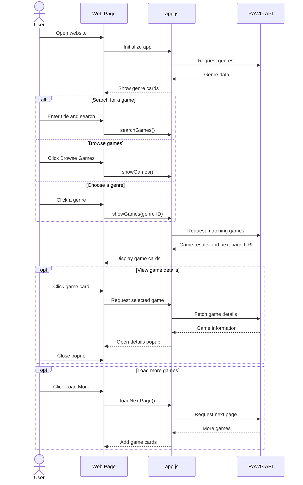

# VideoGameSearch

VideoGameSearch is a website for finding video games. It uses the [RAWG API](https://rawg.io/apidocs) to show game information such as ratings, release dates, genres, and platforms.

## Features

- Search for games by name.
- Browse games and genres.
- Click a game to view its details.
- Load more results when available.

## How to Run

1. Download and extract the project files.
2. Open a terminal in the folder containing `index.html`.
3. Run:

   ```bash
   python -m http.server 8000
   ```

4. Open **http://localhost:8000** in your browser.

## User Manual

1. **Browse Games:** Click **Browse Games** to see game listings.
2. **Browse Genres:** Click **Genres**, then select a genre to see matching games.
3. **Search:** Enter a game title in the search box and click **Search** or press **Enter**.
4. **View Details:** Click a game card to see more information.
5. **Close Details:** Click **X** or press **Escape**.
6. **More Games:** Click **Load More** if you want additional results.

**Troubleshooting:** If games don't load, check your internet connection, local server, and RAWG API key. If a search returns nothing, try another title.

## Technical Manual

### Technologies

- **HTML:** Website structure
- **CSS:** Design and layout
- **JavaScript:** Searches, navigation, and displaying results
- **RAWG API:** Video game data

### Project Files

```text
VideoGameSearch/
├── index.html             # Page layout
├── style.css              # Styling
├── app.js                 # Main logic and API requests
└── components/
    ├── genres.js          # Genre cards
    ├── modal.js           # Game cards
    └── popup.js           # Game details popup
```

### How It Works

1. `app.js` requests game or genre data from RAWG.
2. JavaScript displays the results as cards.
3. Clicking a card fetches and opens more details in a popup.
4. **Load More** requests another page of results when available.

### Program Flow (Sequence Diagram)


## Credits

Game information is provided by the [RAWG Video Games Database](https://rawg.io/).
